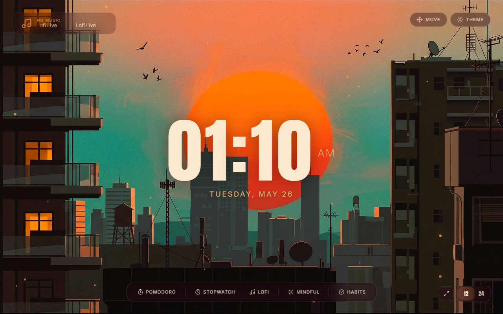

# soumya.dev

**Where Creativity Meets Results** — a modern, dark-themed personal portfolio for Soumya, a full-stack developer and ML/AI engineer.

Live: [soumya.dev](https://soumya-dev-nine.vercel.app/)

---

## Preview

<p align="center">
  
</p>

A highly polished single-page portfolio featuring:
- AI neural network canvas visualization in the hero
- Custom cursor with magnetic ring effect
- Infinite marquee tech stack showcase
- Scroll-triggered reveal animations
- Gridline overlays for a technical aesthetic
- Dark theme with orange accent palette

---

## Sections

| Section | Content |
|---------|---------|
| **Hero** | Bold typography, neural network canvas, ML Engineering USP card |
| **Services** | ML & AI Engineering, Web Stack, Scalable Code — each with skill tags |
| **Tech Stack** | Infinite marquee of Devicon tech icons (Scikit-Learn, TensorFlow, React, etc.) |
| **Featured Work** | 3 case studies: Ambient Habit (Next.js + AI), Flowline CRM (React + Node), ClusterCart (React + Web3) |
| **About** | Bio, hackathon & project stats, personal photo |
| **Contact** | Email link, GitHub, LinkedIn, mail-to button |

---

## Project Structure

```
portfolio/
├── index.html              # Single-page portfolio (all sections in one file)
├── vercel.json             # Vercel static site deployment config
├── README.md
├── css/
│   └── style.css           # All styles — tokens, layout, animations, responsive
├── js/
│   └── main.js             # Custom cursor, marquee builder, scroll reveal, neural canvas
└── img/
    ├── avatar.png          # About section profile photo
    ├── project-1.png       # Ambient Habit screenshot
    ├── project-2.png       # Flowline CRM screenshot
    └── project-3.png       # ClusterCart screenshot
```

---

## Tech Stack

### Frontend
- HTML5, CSS3 (custom properties, flexbox, grid)
- Vanilla JavaScript (no framework)
- HTML5 Canvas (neural network particle animation)
- [Google Fonts](https://fonts.google.com/) — Bebas Neue, Barlow, Barlow Condensed
- [Devicons](https://devicon.dev/) — tech stack icons

### Deployment
- [Vercel](https://vercel.com) — static hosting with `vercel.json`

---

## Key Features

### Neural Network Animation
Canvas-based particle system simulating neural connections in the hero background. Built with vanilla JS and `requestAnimationFrame`.

### Custom Cursor
Dot + magnetic ring cursor that follows the mouse with smooth interpolation. Expands on interactive elements (links, buttons).

### Scroll Reveal
Intersection Observer-based reveal system. Sections fade and slide in as they enter the viewport.

### Tech Marquee
Infinite horizontal scroll animation built dynamically from a tech stack array. Smooth GPU-accelerated CSS transforms.

### Responsive Design
Fully responsive across mobile, tablet, and desktop breakpoints. Collapses nav, adjusts typography scale, and reflows layouts.

---

## Getting Started

### Local Development

```bash
# Clone the repo
git clone https://github.com/Okpiyiii/portfolio.git
cd portfolio

# Serve with any static server
npx serve .
# Or with Python
python -m http.server 8000
```

Open `http://localhost:8000` in your browser.

---

## Deployment

The site is configured for Vercel via `vercel.json`. Any push to the default branch will trigger an automatic deployment.

```bash
vercel deploy --prod
```

---

## Author

**Soumya** — ML/AI Engineer & Full-Stack Developer

- GitHub: [@Okpiyiii](https://github.com/Okpiyiii)
- LinkedIn: [Soumyadeep Pal](https://www.linkedin.com/in/soumyadeep-pal-1a9929380)
- Email: soumyadeeppal4211@gmail.com

---

## License

This project is open source and available under the [MIT License](LICENSE).
